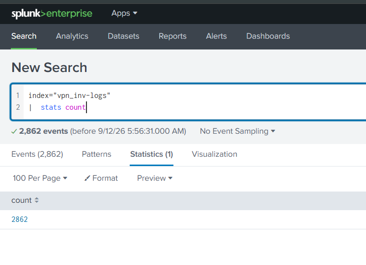
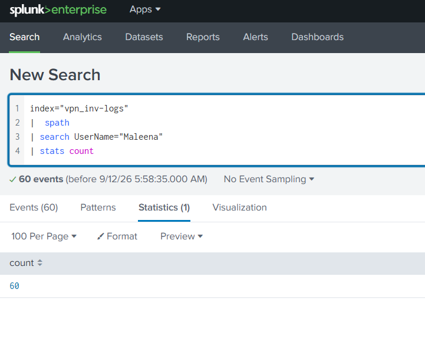
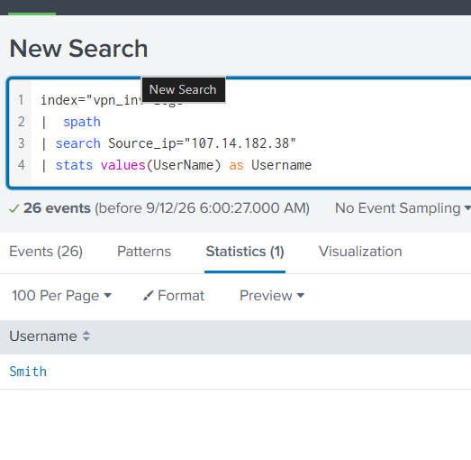
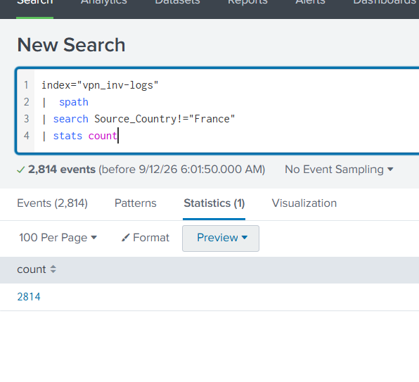
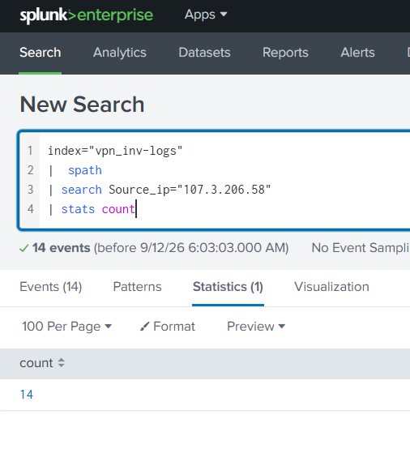

# Basic VPN Log Investigation with Splunk

## Objective

This project was created to practice basic Splunk
and SPL skills by investigating VPN log data.

## Tools Used

- Splunk
- SPL
- VPN log dataset

---

# Investigation

## 1. How many events are present in the log file?

### SPL Query

```spl
index="vpn_inv-logs
| stats count"
```
## Result 
***2862 events*** 




## 2. How many log events are captured by the user Maleena?


```spl
index="vpn_inv-logs
| spath
| search UserName="Maleena"  
| stats count 
```
## Result 
***60 events*** 





## 3. What is the username associated with IP 107.14.182.38?

```spl
index="vpn_inv-logs
| spath
| search Source_ip="107.14.182.38""  
| stats values(UserName) as Username
```

## Result 
***Smith *** 





## 4. What is the number of events that originated from all countries except France?

```spl
index="vpn_inv-logs
| spath
| search Source_Country!="France"  
| stats count 
```
## Result 
***2814 events*** 




## 5. How many VPN events were associated with the IP 107.3.206.58?


```spl 
index="vpn_inv-logs" 
|  spath 
| search Source_ip="107.3.206.58" 
| stats count 
```
## Result 
***14 events*** 





## What I learned

While doing this small investigation, I practiced:

- How Splunk indexes work
- Basic SPL searches
- Searching using fields and values
- Filtering log data
- Counting events
- Investigating users and IP addresses
- Understanding information contained in VPN logs

## What I want to learn next

This was just a basic exercise. As I continue learning SOC Level 1, I want to come back to projects like this and make them more advanced with better investigations and more complex SPL queries.

## Note

This is a learning project I made while studying SOC Level 1. The main purpose of this project is to practice what I learn and get better at investigating and documenting security logs.